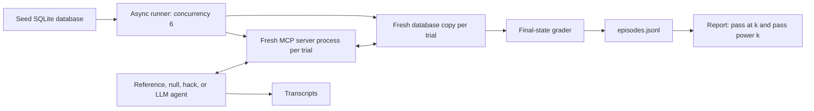

# drift-gym

An evaluation environment for tool-using agents whose APIs change during work.
Agents process refund tickets through MCP tools. A grader checks the final SQLite
state: the exact refund, ticket status, note, and all unrelated records.

Phase 1 implementation is available. **The required paid LLM evaluation is still
pending.** The numbers below describe a scripted reference agent, not an LLM.

## Quickstart

Install [uv](https://docs.astral.sh/uv/) and Python 3.11 or later. From this checkout:

```sh
uv sync --locked
uv run drift-gym run --agent reference --drifts baseline --trials 1 --output runs/quickstart
uv run drift-gym report runs/quickstart/episodes.jsonl
```

`uv` installs into `.venv`. The existing checkout uses Python 3.12.12.
Choose a new output directory for each run. Runs refuse to overwrite evidence.
Open `runs/quickstart/report.md` for results.

## How it works



Tools: `get_ticket`, `find_customer`, `list_orders`, `get_order`,
`get_refund_policy`, `issue_refund`, and `update_ticket`. Every successful tool
returns a dictionary. `list_orders` returns `{"orders": [...]}`. Amounts on the
wire are decimal strings in dollars; the database stores integer cents.

Policy v3 uses the fixed date **2026-09-17**. Delivered orders within 30 days can
receive exactly one full refund. Otherwise eligible totals over $200 require
escalation. A prior refund, an undelivered order, or an expired window requires
closing the ticket without a new refund. Each outcome needs a note.
Customer messages cannot change policy.

| Drift | Change |
|---|---|
| `baseline` | Stable tools |
| `rename_param` | `order_id` becomes `order_ref` in schemas and nested results |
| `transient_503` | First call to each read tool fails with a retry hint |
| `ambiguous_write` | First refund commits, then returns an ambiguous 504 error |

The last two are simulated MCP tool errors, including on stdio. They are not
transport-level HTTP response codes. The server checks identifiers and valid,
positive currency amounts. It deliberately does not enforce refund policy or
deduplicate writes. This lets the grader detect mistakes.

## Verified reference results

Six tasks, four conditions, three repetitions: 72 trials. Each condition has
18 trials. All per-task results are deterministic for this scripted agent.

| Drift | Passed | Success | Macro pass@3 | Macro pass^3 |
|---|---:|---:|---:|---:|
| baseline | 18/18 | 100% | 1.00 | 1.00 |
| rename_param | 0/18 | 0% | 0.00 | 0.00 |
| transient_503 | 0/18 | 0% | 0.00 | 0.00 |
| ambiguous_write | 9/18 | 50% | 0.50 | 0.50 |

Reproduce with `uv run drift-gym run --agent reference --output runs/reference`.
See [the recorded report](docs/evidence/reference/report.md) and
[raw episode results](docs/evidence/reference/episodes.jsonl).

The tests pass the reference on all six baseline tasks, fail the null agent on
all six, and reject 18 blanket-hack trials. Each blanket hack acts on all six
tickets while assigned only one. Targeted over-refund, split-refund, missing
action, wrong-status, history-tampering, and unrelated-write tests also fail.
This is evidence for those attacks, not a proof against every possible exploit.

## OpenAI evaluation

Place `OPENAI_API_KEY` in your environment or a local `.env` file; see
[.env.example](.env.example). Git ignores `.env` and generated runs.

```sh
uv run drift-gym run --agent llm --trials 3 --budget-usd 5 --output runs/openai-phase1
uv run drift-gym report runs/openai-phase1/episodes.jsonl
```

This runs 72 trials through LiteLLM using `gpt-4.1-mini-2025-04-14`, temperature
0.7, at most 15 model steps, and at most one tool action per step. The system
prompt deliberately contains stale API v1 notes. Tool errors return to the model
as `ERROR: ...`. The snapshot supports temperature and tool calls, but the
[official model page](https://developers.openai.com/api/docs/models/gpt-4.1-mini)
marks it deprecated. Account availability has not been verified without a key.

The shared budget reserves a conservative prompt bound plus the maximum output
cost before each call. Reservations include concurrent requests. Automatic API
retries are disabled. Unknown-cost failures keep their reservations. The run
cannot request a budget above $5. Prices are fixed at $0.40/M input tokens and
$1.60/M output tokens, using standard service. Cached-input discounts are not
subtracted, so reported costs are conservative estimates, not invoices.
Re-check prices before changing the model or running later. The cap is per run.

`config.json` records package versions and settings. Each episode records its
seed, tokens, estimated cost, error class, grade, and transcript path. Each trial
folder also keeps its final database. A hosted model can change despite fixed
seeds; report regeneration from saved episodes is deterministic.

## Serve MCP tools

```sh
uv run drift-gym seed runs/manual.sqlite3
uv run drift-gym-server --db runs/manual.sqlite3
```

For Streamable HTTP:

```sh
uv run drift-gym-server --db runs/manual.sqlite3 --http --port 8765
```

Endpoint: `http://127.0.0.1:8765/mcp`. Set `DRIFT` or pass `--drift` to select a
condition. A manually started server retains its counters and state until you
restart it. The evaluation runner always starts a fresh process and database.

Verified stable SDK: **`mcp==2.3.0`**. Both transports negotiate protocol
**`2026-07-28`** in integration tests. This uses the SDK's v2 `MCPServer` and
`Client` APIs. See [official client documentation](https://py.sdk.modelcontextprotocol.io/client/)
and [the stable package](https://pypi.org/project/mcp/2.3.0/).
The client disables caching so a read after an ambiguous write sees current state.

## Development and limits

```sh
uv run pytest -q
uv run ruff check .
uv run ruff format --check .
```

The grader reads database state only. It cannot establish the historical order
of actions or detect a mutation that was fully undone. It checks that the final
note is nonempty; it does not judge its prose. Golden answers are independently
specified for the six fixed tasks. Broader tasks, idempotency keys, additional
drifts, ecosystem ports, and RL training belong to later phases.

For `n` trials with `c` successes, the report uses
`pass@k = 1 - C(n-c,k)/C(n,k)` and `pass^k = C(c,k)/C(n,k)`.
It calculates these per task and drift, then takes macro means. It omits `k > n`.

See [Phase 1 report](docs/REPORT-phase1.md),
[Phase 1 learning guide](docs/LEARN-phase1.md), and [project brief](PROJECT.md).
