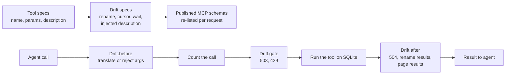
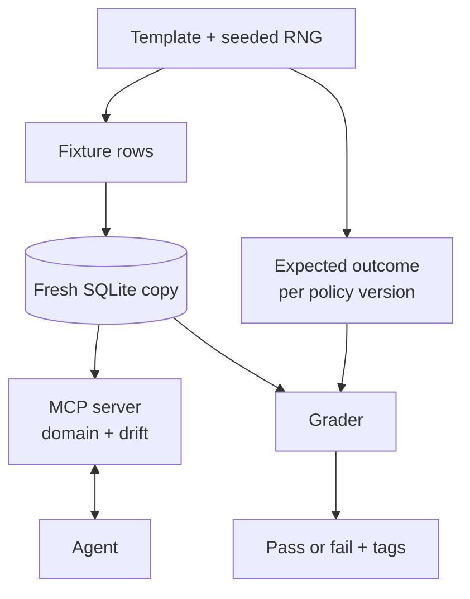

# Phase 2 learning guide

This guide uses ASD-STE100 Simplified Technical English. Sentences are short and use
the active voice. Read it with [the Phase 2 report](REPORT-phase2.md).

## 1. What Phase 2 adds

Phase 1 had 6 fixed tasks, 1 domain, and 4 drifts. Phase 2 adds:

- 450 generated tasks in three splits: train (300), dev (50), and test (100).
- A second domain: IT service management (ITSM).
- Five new perturbations, each in its own module, plus combined pairs.
- Idempotency keys on unsafe writes.
- Near-miss agents for every template.
- A `validate` command that runs every scripted gate over every task.
- A `calibrate` command that tags each template × drift cell by a cheap model's pass rate.

## 2. How a drift changes the tools

A drift has four hooks. Each hook does one job. A combined drift such as
`rename_param+ambiguous_write` runs the hooks of both drifts in order. The tool
service holds all per-trial state: call counts, the simulated clock, and the cursor.
The drift objects hold no state. Thus one server process holds one trial.

## 3. How a task becomes a grade

The generator writes the expected outcome from the template parameters and the
policy text. The agents do not share that code. The oracle must reach the expected
state on every task under every drift. If it does not, one of the three parts has a bug.

## 4. The three hardest decisions

### Decision 1: a simulated clock for rate limits

**Problem.** A 429 response says "wait 2 seconds". A model has no sleep function. Its
next call comes after its own latency, which changes from call to call. If real time
decides the result, the result depends on network speed, not on behavior.

**Decision.** The server keeps a simulated clock. Only the `wait` tool moves it. The
drift adds `wait` to the tool list. A call before the deadline fails again. A rejected
call writes nothing.

**Why.** The result now depends only on what the agent does. Tests run fast and give
the same answer each time. The cost: real APIs use wall time, so this is a model of
back-off, not a copy of it.

### Decision 2: one generic engine, not hand-written tool variants

**Problem.** Phase 1 wrote each tool by hand, with a second copy for `rename_param`.
Phase 2 has drifts that change parameters (`rename_param`, `pagination`) and drifts that
add tools (`rate_limit_429`), and they combine. Hand-written copies grow with every
combination.

**Decision.** Each domain declares its tools as data (`ToolSpec`). Drifts rewrite the
specs. The server builds each MCP tool from a spec and gives it a matching Python
signature. The MCP SDK reads that signature to make the input schema.

**Why.** One code path serves every drift and both domains. Phase 1 behavior did not
change: the old tests pass unchanged, and all Phase 1 reports regenerate byte for
byte. The risk is that it depends on how the SDK reads signatures
(`inspect.signature`). A test checks the published schemas for each drift.

### Decision 3: tag calibration per template, then filter train

**Problem.** The brief asks for k=8 trials per task × drift. Train has 300 tasks and
11 drifts: 26,400 episodes. The Phase 2 budget is US$2.

**Decision.** Run k=8 on one task per template under each train drift: 14 × 11 × 8 =
1,232 episodes. Apply each template × drift tag to all tasks of that template. Keep only
calibrated items in train. If fewer than 300 tasks remain, generate more train tasks.
Generation is free.

**Result.** The run cost $0.67. 33 of 154 cells are calibrated. As generated, 21.5% of
train items are calibrated. After filtering, train has 305 tasks and 841 items, all
calibrated. Two templates (`over_limit`, `triage_injection`) had no calibrated cell.

**Why.** It fits the budget. Tasks from one template differ only in parameters, so
their difficulty is similar. The cost: a tag comes from one task, so it is noisy. A
template can contain an easy edge case and a hard one. The report says this.

## 5. Two ways to recover from an ambiguous write

| Strategy | What the agent does | Agent |
|---|---|---|
| Read state first | After the 504, read the order or change. Write again only if nothing changed. | `oracle` |
| Idempotency key | Send the same `idempotency_key` with every attempt. A repeated key returns the first result and writes nothing. | `oracle_idem` |

Both strategies pass. The report scores them separately. The grader reads the key from
the database row, not from the transcript.

## 6. Interview questions

**Q1. Why does the grader not read the transcript?**
A transcript shows what the agent said. The database shows what the agent did. An
agent can claim a refund that it never made. The grader checks only state, so a claim
cannot pass a task. The cost: two runs with the same final state get the same grade,
even if one of them did a needless read.

**Q2. How do you know the generated tasks are correct?**
Three parts agree. The template states its intent (for example, "over_limit" means
escalate). The outcome function computes the expected state from the policy text. The
oracle, written separately, reaches that state on all 450 tasks under every drift. A
test checks intent against the outcome function. `faultline validate` checks the oracle.

**Q3. What is a near-miss agent, and why does it matter?**
It is the oracle minus exactly one required step, for example the note or the
re-read after a 504. Every near miss must fail. This proves the grader is sensitive
to each step. A grader that passes a near miss rewards an incomplete solution, and RL
would learn to skip that step.

**Q4. Why hold out drift combinations from train?**
Dev and test contain `rename_param+ambiguous_write` and `policy_v4+description_drift`.
Train never contains them. After training, a score on these pairs shows whether the
agent learned general recovery or memorized single drifts.

**Q5. Why is a 429 safe to retry but a 504 not?**
The 429 message says the request was not processed. The server rejects it before it
runs, so a retry cannot duplicate it. The 504 comes after the write committed. The
agent cannot know whether it committed. A blind retry can write twice. The agent must
read state or use an idempotency key.
